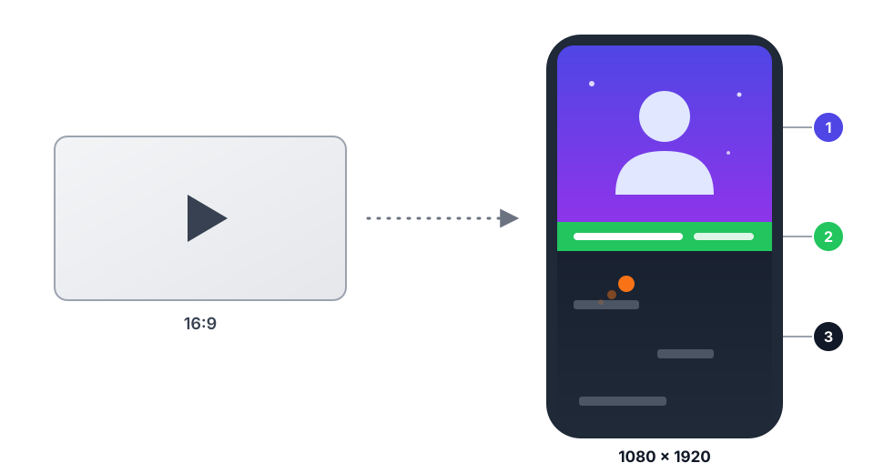

<div align="center">


# Avtonarezka

**Vertical TikTok clips from long videos. Everything runs on your own computer.**

[](https://github.com/6hp2cfrhm4-cmyk/avtonarezka/releases/latest)
[](#installation)
[](https://tauri.app)
[](https://www.rust-lang.org)

[Русский](README.md) · **English**

[Download](#installation) · [How it works](#how-it-works) · [TikTok](#tiktok) · [Build](#building-from-source)

<picture>
  <source media="(prefers-color-scheme: dark)" srcset="docs/layout-dark.svg">
  
</picture>

**1** top of the frame: the whole 16:9 video over a blurred copy of itself; at the most interesting moment the frame freezes · **2** green-screen banner on the split line · **3** gameplay at the bottom

</div>

## What it is

Avtonarezka is an app for Arch Linux and Windows 11. You load a long video (or paste a YouTube link), and the app
finds the best moments in it and turns them into vertical 1080×1920 clips. The top of the frame shows the video, the
bottom shows gameplay (parkour, CS). At the most interesting moment the top freezes and a banner slides in on the split line.

The app finds moments by itself: from speech, laughter, loudness and scene changes, and a language model rates what is
worth showing. You pick the moments, edit the drafts and publish.

**Why local:**

- Analysis runs on your machine: Whisper, YAMNet and Qwen3-4B work without internet and without subscriptions.
- No video is uploaded for analysis. Only what you publish goes to TikTok.
- A GPU speeds up analysis through Vulkan. Without one, everything runs on the CPU, just more slowly.

## How it works

| Step | Screen | What happens |
| :-: | --- | --- |
| 1 | **Import** | Pick a file or paste a YouTube link |
| 2 | **Analysis** | Speech is transcribed; laughter, applause, loudness and scene changes are detected; a language model rates the fragments |
| 3 | **Moments** | Pick the best spots yourself or let the automatic mode do it |
| 4 | **Drafts** | The app makes quick drafts; you adjust style, background and banner |
| 5 | **Final** | Renders 1080×1920 and publishes to TikTok |

## Features

- **Three cutting modes:** manual, automatic, or fixed chunks of N seconds.
- **"Video is already cut".** If nothing needs to be removed, the whole video is cut into consecutive clips with no gaps,
  with boundaries placed in pauses between sentences and at scene changes.
- **16:9 video stays fully visible.** It takes the full width of the frame and a blurred copy of it fills the space above and below.
  Vertical sources still fill the top half.
- **Gameplay follows the timecodes.** The background is cut at the same seconds as the main video: the clip at 10:00 gets the
  background from 10:00. Whatever is left of the gameplay goes to the next video and is used up to the end; several backgrounds
  play in order, then loop.
- **Word-level subtitles** (Whisper large-v3-turbo). If the source has big burned-in subtitles, you can crop them off the bottom.
- **Asset library:** backgrounds, banners and fonts. Montserrat is bundled with the app.
- **YouTube downloads** via yt-dlp: paste a link, Ctrl+V does the rest, 1080p by default.
- **TikTok publishing** through the official API or through a browser.
- **Interface with 3D animations.** The draft editor controls style, background, banner and frame position.

## Installation

Ready-made packages are on the [Releases](https://github.com/6hp2cfrhm4-cmyk/avtonarezka/releases/latest) page. Checksums are in `SHA256SUMS`.

### Arch Linux

```bash
sudo pacman -U avtonarezka-0.1.1-1-x86_64.pkg.tar.zst
```

pacman installs the dependencies: `ffmpeg`, `webkit2gtk-4.1`, `libsecret`, `vulkan-icd-loader`, `yt-dlp`, `deno`.
You also need an `ffmpeg` build with `h264_nvenc` and `libass`, and a Vulkan driver for your GPU
(`vulkan-nvidia`, `vulkan-radeon` or `vulkan-intel`).

### Windows 11

1. Download `avtonarezka-0.1.1-windows-x64-setup.exe` and run it. No administrator rights are needed.
2. SmartScreen will warn about an unknown publisher. The installer is not signed yet: click **More info → Run anyway**.
3. Download the models (see below) with `fetch-models.ps1` from the Releases page.

ffmpeg, ffprobe, yt-dlp and Deno are already included in the installer. You don't need to install them separately.

### Models (about 3 GB, once)

The models are not included in the packages. The script downloads them and verifies SHA256 checksums; an interrupted download can be resumed.

```bash
scripts/fetch-models.sh                    # from the source tree
/usr/share/avtonarezka/fetch-models.sh     # if you installed the Arch package
```

Windows: `powershell -ExecutionPolicy Bypass -File fetch-models.ps1`.

The models go to `~/.local/share/app.avtonarezka.desktop/models` (Linux) or `%LOCALAPPDATA%\app.avtonarezka.desktop\models` (Windows).

| Model | Used for | Size |
| --- | --- | --- |
| Whisper large-v3-turbo (q5_0) | speech and word-level subtitles | 574 MB |
| YAMNet | laughter, shouting, applause | 16 MB |
| Qwen3-4B (Q4_K_M) | titles, captions, moment scoring | 2.5 GB |

Without the models the app still works, but skips speech recognition, laughter detection and language-model scoring.
The Analysis screen says so. An NVIDIA GPU with 4 GB of VRAM is enough for these models: Whisper and the language model
run on it through Vulkan, and fall back to the CPU if something fails.

## YouTube

On the Import screen, open the "YouTube link" tab, or just press Ctrl+V with a link in the clipboard: the tab opens by itself.
Choose the quality (1080p by default) and click "Download". The file shows up in your projects, then click "Find moments".

- You need `yt-dlp` and `deno`. yt-dlp must be version 2026.10.26 or newer: YouTube changes often, and older versions break.
  The "yt-dlp" badge at the top of the window shows the status. On Windows everything is already in the installer.
- One video, no playlists. Video and audio are merged by ffmpeg without re-encoding; an interrupted download can be resumed.
- For 720p and 1080p the app asks for H.264 + AAC in MP4, because preview, analysis and rendering are built around it.
- Downloads go to `~/Videos/Автонарезка/Скачанное` (Windows: `%USERPROFILE%\Videos\Автонарезка\Скачанное`).

## TikTok

There are two ways, chosen on the Final screen in the TikTok settings.

**Official API.** You need an app on [developers.tiktok.com](https://developers.tiktok.com) with the Login Kit and
Content Posting API products. In Login Kit add the redirect URI `http://127.0.0.1:38475/callback/` (the port can be changed
in the settings), then enter the Client key and Client secret in the app. The secret is stored in your system keyring
(libsecret on Linux, Credential Manager on Windows), not in the app database. Until the app passes TikTok's audit,
you can only publish with "Only me" visibility, and at most 5 drafts per day.

**Through the browser.** The app opens Chromium or Edge with a separate profile and fills in the upload page. You sign in
to your account yourself in that window. This depends on TikTok's page layout and can break after a TikTok update.

## Data

Everything lives in `~/.local/share/app.avtonarezka.desktop/` (Windows: `%LOCALAPPDATA%\app.avtonarezka.desktop\`):
the `avtonarezka.db` database, models and draft previews. Finished clips are saved to `~/Videos/Автонарезка` by default
(Windows: `%USERPROFILE%\Videos\Автонарезка`); you can change the folder on the Final screen.

## Troubleshooting

- **Blank or flickering window** (Wayland, hybrid graphics): run `WEBKIT_DISABLE_DMABUF_RENDERER=1 avtonarezka`.
- **Slow analysis:** check that a Vulkan driver is installed (`vulkaninfo --summary`). Without it everything runs on the CPU,
  where Whisper works at about real-time speed.
- **Subtitles in a different font:** Montserrat is copied to `fonts/` next to the data on first launch. If you delete that folder,
  the fonts come back on the next launch.

## Building from source

You need Rust, Node.js, `cmake`, `clang`, `vulkan-headers`, `spirv-headers`, `shaderc` and the Tauri system libraries
(`webkit2gtk-4.1`, `gtk3`).

```bash
npm ci
scripts/build-release.sh        # language-model worker → Tauri bundles → Arch package
```

The Windows installer is built from Linux with a single command: `windows/build-windows.sh`. See
[windows/README.md](windows/README.md) for details.

Development: `npm run tauri dev`. Tests: `cd src-tauri && cargo test` (heavy checks on real models:
`cargo test -- --ignored`).

## Status

Version 0.1.1. The Arch package is built and in use. The Windows installer is built on Linux and
tested under Wine, but it has not yet been run on a real Windows 11 machine. Found a problem? Open an [issue](https://github.com/6hp2cfrhm4-cmyk/avtonarezka/issues).

## License

No license has been chosen yet: without one, all rights stay with the author. The Montserrat font (in `assets/fonts`) is
under the SIL Open Font License. The Windows installer includes ffmpeg, yt-dlp, Deno and the Vulkan loader, each under its own license.
The models have their own licenses too: check them before you share results.
