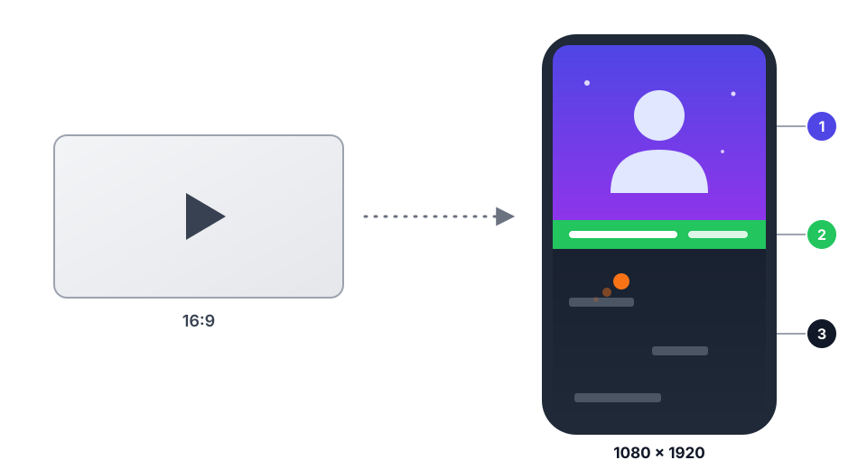

<div align="center">


# Автонарезка

**Из длинного видео — вертикальные ролики для TikTok. Всё считается на твоём компьютере.**

[](https://github.com/6hp2cfrhm4-cmyk/avtonarezka/releases/latest)
[](#установка)
[](https://tauri.app)
[](https://www.rust-lang.org)

**Русский** · [English](README.en.md)

[Скачать](#установка) · [Как это работает](#как-это-работает) · [TikTok](#tiktok) · [Сборка](#сборка-из-исходников)

<picture>
  <source media="(prefers-color-scheme: dark)" srcset="docs/layout-dark.svg">
  
</picture>

**1** верх кадра: видео 16:9 целиком, пустое место заливает его размытая копия; в самый интересный момент кадр замирает · **2** баннер с зелёным фоном на линии раздела · **3** геймплей внизу

</div>

## Что это

Автонарезка — приложение для Arch Linux и Windows 11. Ты загружаешь длинное видео (или ссылку на YouTube), а программа
находит в нём лучшие моменты и собирает из них вертикальные ролики 1080×1920. Сверху кусок видео, снизу геймплей
(паркур, CS). В самый интересный момент верхняя часть кадра замирает, и на линии раздела выезжает баннер.

Моменты программа ищет сама: по речи, смеху, громкости и смене кадра, а языковая модель оценивает, что стоит показать.
Ты отбираешь, правишь черновики и публикуешь.

**Почему локально:**

- Анализ идёт на твоём компьютере: Whisper, YAMNet и Qwen3-4B работают без интернета и без подписок.
- Для анализа видео никуда не загружается. В TikTok уходит только то, что ты сам опубликуешь.
- Видеокарта ускоряет анализ через Vulkan. Без неё всё работает на процессоре, просто медленнее.

## Как это работает

| Шаг | Экран | Что происходит |
| :-: | --- | --- |
| 1 | **Импорт** | Выбираешь файл или вставляешь ссылку на YouTube |
| 2 | **Анализ** | Распознаётся речь, ищутся смех, аплодисменты, громкость и смена кадра; языковая модель оценивает фрагменты |
| 3 | **Моменты** | Отбираешь лучшие места или доверяешь автоматическому режиму |
| 4 | **Черновики** | Программа делает быстрые черновики; ты правишь стиль, фон и баннер |
| 5 | **Финал** | Рендер 1080×1920 и публикация в TikTok |

## Возможности

- **Три режима нарезки:** вручную, автоматически или кусками по N секунд.
- **«Видео уже размечено».** Если из видео ничего вырезать не нужно, программа нарежет его целиком подряд: без пропусков,
  с границами в паузах между фразами и на сменах сцены.
- **Видео 16:9 видно целиком.** Оно занимает всю ширину кадра, а пустое место сверху и снизу заливает размытая копия. Вертикальные
  исходники по-прежнему заполняют верхнюю половину.
- **Геймплей по таймкодам.** Фон нарезается по тем же секундам, что и основное видео: клип с 10:00 берёт фон с 10:00. Что осталось
  от геймплея, достаётся следующему видео и используется до конца; несколько фонов идут по порядку, потом по кругу.
- **Субтитры по словам** (Whisper large-v3-turbo). Если в исходнике вшиты крупные субтитры, их можно срезать снизу.
- **Библиотека ассетов:** фоны, баннеры и шрифты. Montserrat вшит в программу.
- **Скачивание с YouTube** через yt-dlp: вставь ссылку, Ctrl+V сделает остальное, по умолчанию 1080p.
- **Публикация в TikTok** через официальный API или через браузер.
- **Интерфейс с 3D-анимациями.** Редактор черновика настраивает стиль, фон, баннер и положение кадра.

## Установка

Готовые пакеты лежат в [Releases](https://github.com/6hp2cfrhm4-cmyk/avtonarezka/releases/latest). Контрольные суммы — в `SHA256SUMS`.

### Arch Linux

```bash
sudo pacman -U avtonarezka-0.2.5-1-x86_64.pkg.tar.zst
```

Зависимости pacman подтянет сам: `ffmpeg`, `webkit2gtk-4.1`, `libsecret`, `vulkan-icd-loader`, `yt-dlp`, `deno`.
Нужны ещё `ffmpeg` с `h264_nvenc` и `libass` и драйвер Vulkan вашей видеокарты (`vulkan-nvidia`, `vulkan-radeon` или `vulkan-intel`).

### Windows 11

1. Скачай `avtonarezka-0.2.5-windows-x64-setup.exe` и запусти. Права администратора не нужны.
2. SmartScreen предупредит о неизвестном издателе. Установщик пока не подписан: нажми **«Подробнее» → «Выполнить в любом случае»**.
3. Скачай модели (см. ниже) скриптом `fetch-models.ps1` из Releases.

Внутри уже есть ffmpeg, ffprobe, yt-dlp и Deno. Ставить их отдельно не нужно.

### Модели (около 3 ГБ, один раз)

Модели в пакеты не входят. Программа скачивает их сама при запуске, если каких-то нет: прогресс идёт полосой
наверху. Проверка по контрольным суммам, прерванную загрузку программа продолжает. Если нужно скачать вручную:

```bash
scripts/fetch-models.sh                    # из исходников
/usr/share/avtonarezka/fetch-models.sh     # если установлен пакет Arch
```

Windows: `powershell -ExecutionPolicy Bypass -File fetch-models.ps1`.

Модели лягут в `~/.local/share/app.avtonarezka.desktop/models` (Linux) или в `%LOCALAPPDATA%\app.avtonarezka.desktop\models` (Windows).

| Модель | Зачем | Размер |
| --- | --- | --- |
| Whisper large-v3-turbo (q5_0) | речь и субтитры по словам | 574 МБ |
| YAMNet | смех, крики, аплодисменты | 16 МБ |
| Qwen3-4B (Q4_K_M) | заголовки, подписи, оценка моментов | 2,5 ГБ |

Без моделей программа работает, но пропускает распознавание речи, смех и оценку языковой моделью. Об этом
написано на экране «Анализ». Видеокарта NVIDIA с 4 ГБ видеопамяти этих моделей хватает: Whisper и языковая модель
работают на ней через Vulkan и при сбое сами переходят на процессор.

## YouTube

На экране «Импорт» открой вкладку «Ссылка YouTube» или просто нажми Ctrl+V с ссылкой в буфере: вкладка откроется сама.
Выбери качество (по умолчанию 1080p) и нажми «Скачать». Готовый файл появится в проектах, дальше жми «Найти моменты».

- Нужны `yt-dlp` и `deno`. Версия yt-dlp не старее 2026.10.26: YouTube часто меняется, и старые версии ломаются.
  Статус показывает значок «yt-dlp» вверху окна. Для Windows всё уже внутри установщика.
- Одно видео без плейлиста. Видео и звук склеиваются ffmpeg'ом без перекодирования; остановленную загрузку
  можно продолжить.
- Для 720p и 1080p программа берёт H.264 + AAC в MP4, потому что на них заточены предпросмотр, анализ и рендер.
- Скачанное лежит в `~/Videos/Автонарезка/Скачанное` (Windows: `%USERPROFILE%\Videos\Автонарезка\Скачанное`).

## TikTok

Два способа, выбираются на экране «Финал» в настройках TikTok.

**Официальный API.** Нужно приложение на [developers.tiktok.com](https://developers.tiktok.com) с продуктами
Login Kit и Content Posting API. В Login Kit добавь адрес возврата `http://127.0.0.1:38475/callback/` (порт меняется
в настройках), затем впиши Client key и Client secret в программу. Секрет хранится в связке ключей системы
(libsecret на Linux, Диспетчер учётных данных на Windows), а не в базе. Пока приложение не прошло аудит TikTok,
публиковать можно только с видимостью «Только я», а в черновики не больше 5 роликов в сутки.

**Через браузер.** Программа открывает Chromium или Edge с отдельным профилем и заполняет страницу загрузки. Войти
в аккаунт нужно самому в этом окне. Способ зависит от вёрстки TikTok и может сломаться после его обновления.

### Автовыкладка всех роликов

На экране «Финал» есть панель «Автовыкладка в TikTok». Она работает только через браузер: длинное описание
не пролезает в API (у него подпись до 2200 знаков).

1. **«Составить описания»**: локальная модель пишет для каждого готового ролика свой текст по его расшифровке и
   до 5 хэштегов. Вместе с хэштегами это строго 3990–3999 знаков. Любое описание можно поправить, счётчик покажет, попадает
   ли оно в окно.
2. **«Запустить выкладку»**: после подтверждения ролики выходят по одному. Между ними пауза (по умолчанию 45 минут).
   Лимит «в сутки на аккаунт» (по умолчанию 5) считается по местным суткам, с полуночи. Выкладывать можно только в окно
   публикации «с … до …» (по умолчанию весь день, время местное). Программа сама нажимает «Опубликовать» и ждёт, пока
   TikTok подтвердит публикацию.

### Пул аккаунтов

В блоке «Аккаунты для выкладки» вставь список аккаунтов, по одному в строке, или загрузи `.txt`. Для каждого нажми
«Войти»: откроется окно браузера с отдельным профилем, в нём войди в TikTok. Пароли программа не видит и не хранит.
Если включено два и больше аккаунта, ролики идут по кругу (первый, второй, потом снова первый), пропуская тех, у кого
лимит на сутки уже выбран. На роликах из пула не ставится надпись «Часть N». Основной аккаунт получает прежний вход.

Что нужно знать:

- Приложение должно оставаться открытым, пока идёт очередь. После перезапуска очередь сама не стартует: нужно запустить её
  заново. Если компьютер уснул, очередь продолжит по часам.
- Если TikTok просит войти или пройти проверку («я не робот»), очередь встаёт на паузу. Проверку проходишь сам в окне
  браузера, программа её не обходит.
- Если после клика «Опубликовать» подтверждения нет, ролик помечается «Проверь в TikTok»: он мог выйти. Повторно такой
  ролик очередь не отправит, пока ты не решишь сам: «Он вышел», «Отправить ещё раз» или «Убрать».
- Видимость ролика берётся из настроек аккаунта в TikTok Studio. Проверь её до запуска.
- Автоматизация сайта не предусмотрена правилами TikTok, возможны ограничения аккаунта. Поэтому лимит по умолчанию
  небольшой.

## Данные

Всё лежит в `~/.local/share/app.avtonarezka.desktop/` (Windows: `%LOCALAPPDATA%\app.avtonarezka.desktop\`):
база `avtonarezka.db`, модели, превью черновиков. Готовые ролики по умолчанию сохраняются в `~/Videos/Автонарезка`
(Windows: `%USERPROFILE%\Videos\Автонарезка`), папку можно сменить на экране «Финал».

## Если что-то не так

- **Пустое или мерцающее окно** (Wayland, гибридная графика): запусти `WEBKIT_DISABLE_DMABUF_RENDERER=1 avtonarezka`.
- **Анализ медленный:** проверь, что стоит драйвер Vulkan (`vulkaninfo --summary`). Без него всё работает на процессоре,
  Whisper идёт примерно в реальном времени.
- **Субтитры другим шрифтом:** Montserrat кладётся в `fonts/` рядом с данными при первом запуске. Если папку удалить,
  шрифты вернутся при следующем запуске.

## Сборка из исходников

Нужны Rust, Node.js, `cmake`, `clang`, `vulkan-headers`, `spirv-headers`, `shaderc` и системные библиотеки Tauri
(`webkit2gtk-4.1`, `gtk3`).

```bash
npm ci
scripts/build-release.sh        # воркер языковой модели → пакеты Tauri → пакет для Arch
```

Установщик для Windows собирается с Linux одной командой: `windows/build-windows.sh`. Подробности в
[windows/README.md](windows/README.md).

Разработка: `npm run tauri dev`. Тесты: `cd src-tauri && cargo test` (тяжёлые проверки на настоящих моделях:
`cargo test -- --ignored`).

## Статус

Версия 0.2.5. Пакет для Arch собран и работает. Установщик для Windows собран на Linux и проверен
в Wine, но на настоящей Windows 11 ещё не запускался. Пул аккаунтов и окно публикации проверены тестами, но
не на живом TikTok. Нашёл проблему? Напиши в [Issues](https://github.com/6hp2cfrhm4-cmyk/avtonarezka/issues).

## Лицензия

Лицензия программы пока не выбрана: без неё все права остаются за автором. Шрифт Montserrat (в `assets/fonts`) распространяется
по SIL Open Font License. В Windows-установщике есть ffmpeg, yt-dlp, Deno и Vulkan-загрузчик, у каждого своя лицензия.
У моделей тоже свои лицензии: проверь их перед тем, как делиться результатами.
